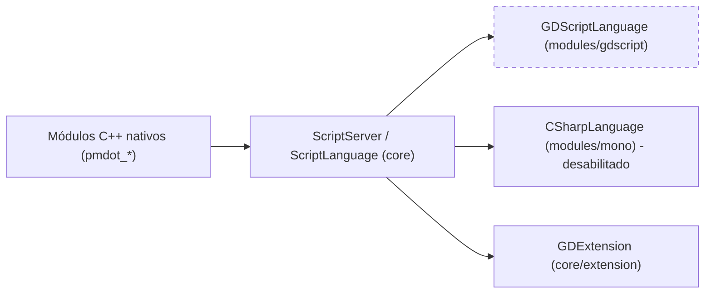

# Architecture — PMDoT Engine

PMDoT é um fork do **Godot Engine 4.3-stable**, mantido pela PMDT Studios.

> Estado documentado: **atual** (GDScript ainda presente) e **alvo** (após o CHG-002, ver `Changes.md`).

---

## 1. Visão de alto nível do repositório


| Caminho | Responsabilidade |
|---|---|
| `pmdot.py` | CLI única: `install`, `version`, `update`, `build` (incremental por segmentos), `run`, `doctor`, `clean`, `--project create` |
| `pmdot`, `pmdot.bat`, `pmdot.ps1` | Wrappers da CLI para Linux/macOS e Windows |
| `build_pmdot.py` | Script de build legado e direto (SCons, `-j4`) |
| `.pmdot_cache/` | Hashes SHA256 dos segmentos de build (ignorado pelo git) |
| `architecture-guidelines/` | Guia técnico do Aseprite/SIMD e referência da CLI |
| `PMDoT Architechture Guide/` | Este guia: arquitetura, módulos, pastas, testes e changelog |
| `source-godot/` | Código da engine (fork do Godot 4.3) |

## 2. Build segmentado (`pmdot build`)

`BUILD_SEGMENTS` em `pmdot.py` divide `source-godot` em 10 segmentos. Cada um tem um hash SHA256 calculado a partir das extensões `.cpp .c .h .hpp .py .inc`:

`godot_core` · `godot_scene` · `godot_servers` · `godot_editor` · `godot_drivers` · `godot_platform` · `godot_main` · `godot_thirdparty` · `godot_modules` (exclui `pmdot_*`) · `pmdot_aseprite`

Comando SCons base (atual):
```
scons platform=<os> target=editor disable_exceptions=no custom_modules=modules/pmdot_aseprite -j8
```
Alvo pós-CHG-002: adicionar `module_gdscript_enabled=no module_jsonrpc_enabled=no` (até a pasta ser apagada fisicamente).

## 3. Camada de scripting



| Estado | Linguagens disponíveis para gameplay |
|---|---|
| Atual | GDScript, GDExtension (C++), módulos nativos |
| Alvo (CHG-002) | **C++ (GDExtension e módulos nativos)** e **C# (módulo `mono` / .NET)**. No futuro, suporte a **Java** também será integrado. |

A camada genérica (`core/object/script_language*`, `ScriptServer`, `core/extension/`) **permanece**. Só a implementação de linguagem GDScript sai.

## 4. Fluxo de inicialização dos módulos

1. `modules/SCsub` lê os `config.py` de cada módulo (`can_build`, `configure`) e gera `modules_enabled.gen.h` com `MODULE_<NOME>_ENABLED`.
2. `register_module_types.gen.cpp` chama `initialize_<modulo>_module(level)` para cada nível (`CORE`, `SERVERS`, `SCENE`, `EDITOR`).
3. Código fora do módulo que depende dele **deve** estar protegido por `#ifdef MODULE_<NOME>_ENABLED`.

## 5. Pipeline Aseprite / Pixel Art
Ver `architecture-guidelines/aseprite_architecture_guide.md` (SIMD AVX2/SSE4.1, `EditorAsepriteWorkspace`, `PMDoTPixelArtPresets`).

## 6. Regras de arquitetura
- Funcionalidade nova da PMDoT vai em **módulo próprio `modules/pmdot_<nome>/`**. Evite alterar `core/`, `scene/` e `editor/` diretamente.
- Toda alteração em arquivo upstream do Godot deve ser registrada em `Changes.md`, com arquivo e linha.
- Dependências entre módulos são declaradas em `config.py` com `env.module_add_dependencies()`.
- Remover módulo: primeiro desabilite por flag, valide, e só então apague a pasta (ver o processo do CHG-002).
