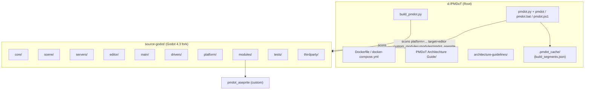
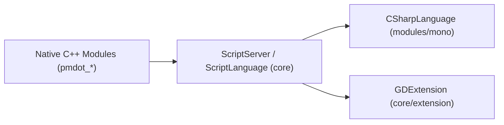

# Architecture — PMDoT Engine

PMDoT is a specialized fork of **Godot Engine 4.3-stable**, maintained by PMDT Studios for high-performance Pixel Art game development.

> Documented state: **Current** (post-CHG-002: GDScript fully removed, native C++ and C# active, Java planned in the roadmap).

---

## 1. High-Level Repository Architecture



| Path | Responsibility |
|---|---|
| `pmdot.py` | Unified CLI: `install`, `version`, `update`, `build` (segmented incremental builds), `run`, `doctor`, `clean`, `--project create` |
| `pmdot`, `pmdot.bat`, `pmdot.ps1` | CLI platform wrappers for Linux, macOS, and Windows |
| `build_pmdot.py` | Standalone direct build script (SCons, `-j4`) |
| `.pmdot_cache/` | SHA256 build segment cache (git-ignored) |
| `architecture-guidelines/` | Low-level technical guidelines for Aseprite/SIMD and CLI reference |
| `PMDoT Architechture Guide/` | Core architectural guide: Architecture, Modules, Path Guidelines, Testing, and Changes |
| `source-godot/` | Engine codebase (Godot 4.3 fork) |

---

## 2. Segmented Incremental Build System (`pmdot build`)

`BUILD_SEGMENTS` in `pmdot.py` segments `source-godot` into 10 independent verification zones. Each computes a composite SHA256 hash across tracked source file extensions (`.cpp`, `.c`, `.h`, `.hpp`, `.py`, `.inc`):

`godot_core` · `godot_scene` · `godot_servers` · `godot_editor` · `godot_drivers` · `godot_platform` · `godot_main` · `godot_thirdparty` · `godot_modules` (excluding `pmdot_*`) · `pmdot_aseprite`

Base SCons invocation:
```bash
scons platform=<os> target=editor disable_exceptions=no custom_modules=modules/pmdot_aseprite module_gdscript_enabled=no module_jsonrpc_enabled=no -j8
```

---

## 3. Scripting and Gameplay Runtime Layer



| State | Supported Gameplay Languages |
|---|---|
| Target / Current | **C++ (GDExtension & Native Engine Modules)** and **C# (`mono` module / .NET)**. In the future, native **Java** runtime support is planned. |
| Legacy (Removed) | GDScript (`modules/gdscript`) and JSON-RPC (`modules/jsonrpc`) have been completely decoupled and removed. |

The core script abstraction layer (`core/object/script_language*`, `ScriptServer`, `core/extension/`) remains in place to serve C# and GDExtension bindings.

---

## 4. Module Initialization Lifecycle

1. `modules/SCsub` scans `config.py` in every module (`can_build`, `configure`) and dynamically generates `modules_enabled.gen.h` with `MODULE_<NAME>_ENABLED` preprocessor macros.
2. `register_module_types.gen.cpp` executes `initialize_<module>_module(level)` for each lifecycle phase (`CORE`, `SERVERS`, `SCENE`, `EDITOR`).
3. External code depending on any module must be guarded with `#ifdef MODULE_<NAME>_ENABLED`.

---

## 5. Aseprite & SIMD Pixel Art Pipeline
For low-level SIMD specifications (AVX2/SSE4.1 routines, `EditorAsepriteWorkspace`, and `PMDoTPixelArtPresets`), refer to `architecture-guidelines/aseprite_architecture_guide.md`.

---

## 6. Architectural Rules
- All new PMDoT features must reside in dedicated custom modules under `source-godot/modules/pmdot_<name>/`. Avoid direct modifications to upstream Godot directories (`core/`, `scene/`, `editor/`).
- Any unavoidable modification to upstream Godot files must be recorded in `Changes.md` with exact file paths and reasoning.
- Inter-module dependencies must be declared in `config.py` using `env.module_add_dependencies()`.
- Module deprecation and removal must follow the standard decoupling and verification lifecycle (flag disablement, source tree cleanup, macro scrubbing, and test suite adjustment).
