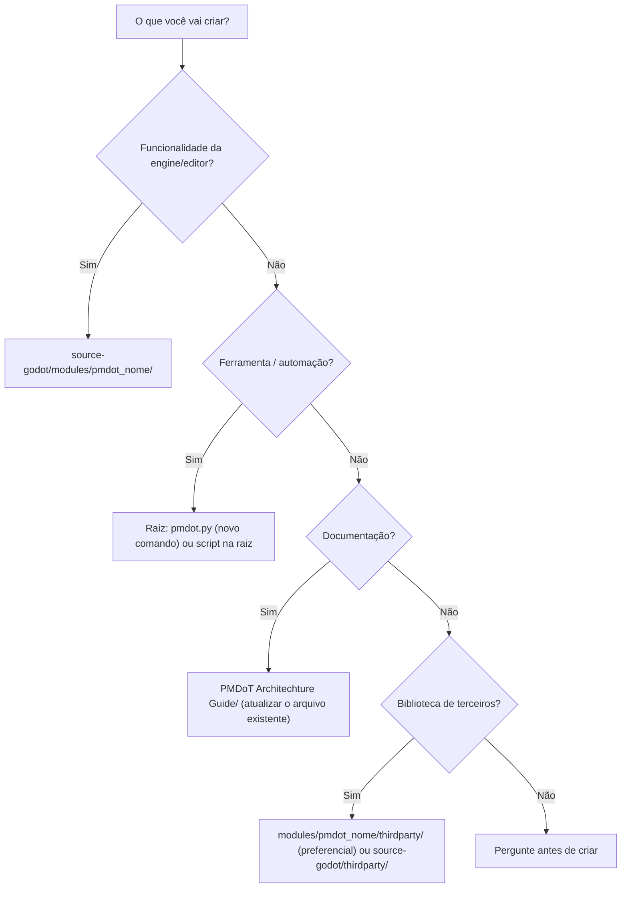

# Folders Path Creation Guide — Onde criar cada coisa

Regras para criar pastas e arquivos no repositório PMDoT, mantendo o build segmentado e a fronteira com o upstream do Godot.

## 1. Mapa de decisão



## 2. Estrutura obrigatória de um módulo PMDoT

```
source-godot/modules/pmdot_<nome>/
├── config.py              # can_build(), configure(), dependências
├── SCsub                  # fontes compilados
├── register_types.cpp/.h  # initialize_/uninitialize_pmdot_<nome>_module
├── <nome>_*.cpp/.h        # runtime (sem dependência do editor)
├── editor/                # código só do editor (protegido por TOOLS_ENABLED)
├── tests/                 # test_<assunto>.h (descoberto automaticamente)
├── doc_classes/           # XML de documentação das classes expostas
├── icons/                 # SVGs de ícones do editor (PascalCase.svg)
└── thirdparty/            # dependências vendorizadas do módulo
```

Regras:
- Nome do módulo: `pmdot_` + `snake_case`. O prefixo é obrigatório porque o segmento `godot_modules` do `pmdot.py` exclui `pmdot_*` e cada módulo PMDoT ganha segmento próprio em `BUILD_SEGMENTS`.
- Adicione o módulo em `custom_modules=` (separado por vírgula) no `scons_cmd` do `pmdot.py`.
- Código de editor fica em `editor/` e só é compilado quando `env.editor_build` é verdadeiro.

## 3. Onde **não** criar arquivos
| Caminho | Motivo |
|---|---|
| `source-godot/core`, `scene`, `servers`, `editor`, `main` | Código upstream. Alterar só quando inevitável e registrar em `Changes.md` |
| `source-godot/modules/gdscript/` | Removido / em remoção (CHG-002). **Não criar nada** |
| `source-godot/bin/`, `.pmdot_cache/`, `.sconf_temp/`, `__pycache__/` | Artefatos gerados (ignorados pelo git) |
| `*.gen.h`, `*.gen.cpp`, `*.obj` | Gerados pelo SCons |
| Arquivos `.gd` em qualquer lugar | GDScript descontinuado na PMDoT |

## 4. Documentação
- Novos documentos de arquitetura vão **dentro dos 5 arquivos** deste guia (`Changes`, `Folders Path creation guide`, `Test guide`, `Architecture`, `Modules`).
- Guias técnicos longos e específicos (ex.: Aseprite) ficam em `architecture-guidelines/` e são referenciados a partir daqui.

## 5. Estrutura de projetos de jogo (`pmdot --project create`)
Pastas geradas pelos padrões de `ARCHITECTURE_PATTERNS` em `pmdot.py`: `mvc`, `feature`, `layer`, `ecs`, `minimal`, `modular`, `standard`.
Após o CHG-002, as pastas `scripts/` desses padrões passam a guardar bindings e arquivos de código em **C# (`.cs`)** e **C++ (GDExtension)** (e futuramente **Java**), e não mais arquivos `.gd`.

