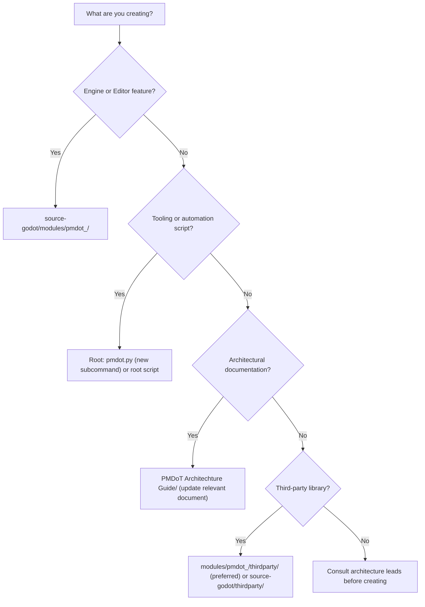

# Folders Path Creation Guide — Directory Standards

Standard operating guidelines for creating directories and files in PMDoT, preserving incremental build segments and clean upstream Godot boundaries.

---

## 1. Decision Flowchart



---

## 2. Mandatory Structure for PMDoT Modules

```
source-godot/modules/pmdot_<name>/
├── config.py              # can_build(), configure(), dependencies
├── SCsub                  # SCons build instructions
├── register_types.cpp/.h  # initialize_/uninitialize_pmdot_<name>_module
├── <name>_*.cpp/.h        # Runtime logic (zero editor dependencies)
├── editor/                # Editor-only UI & logic (guarded with TOOLS_ENABLED)
├── tests/                 # test_<feature>.h (automatically registered)
├── doc_classes/           # Class documentation XMLs
├── icons/                 # Editor SVGs (PascalCase.svg)
└── thirdparty/            # Vendorized libraries
```

### Module Standards:
- **Naming format:** `pmdot_` + `snake_case`. The prefix is strictly mandatory because `BUILD_SEGMENTS` in `pmdot.py` treats `pmdot_*` as independent build segments and excludes them from generic `godot_modules`.
- Include the module in `custom_modules=` (comma-separated) within `pmdot.py`.
- Editor code must reside exclusively in `editor/` and only be included when `env.editor_build` is enabled.

---

## 3. Restricted Directories (Do NOT create files here)
| Path | Reason |
|---|---|
| `source-godot/core`, `scene`, `servers`, `editor`, `main` | Upstream Godot core codebase. Avoid direct modifications; log mandatory edits in `Changes.md`. |
| `source-godot/modules/gdscript/` | Deprecated and purged (CHG-002). Never recreate files here. |
| `source-godot/modules/webxr/` | Deprecated and purged (CHG-004). Never recreate files here. |
| `source-godot/platform/android/` | Purged (CHG-004). Mobile platforms are not supported. |
| `source-godot/platform/ios/` | Purged (CHG-004). Mobile platforms are not supported. |
| `source-godot/platform/web/` | Purged (CHG-004). Web platforms are not supported. |
| `source-godot/bin/`, `.pmdot_cache/`, `.sconf_temp/`, `__pycache__/` | Ephemeral build outputs (ignored by git). |
| `*.gen.h`, `*.gen.cpp`, `*.obj` | Generated by SCons during compilation. |
| `*.gd` files | GDScript is deprecated and removed across all PMDoT projects. |

---

## 4. Documentation Standards
- Core architectural documentation must be updated within the 5 core documents of `PMDoT Architechture Guide/` (`Changes`, `Folders Path creation guide`, `Test guide`, `Architecture`, `Modules`).
- Deep technical subsystem guidelines (e.g., Aseprite SIMD pipelines) are placed in `architecture-guidelines/` and cross-referenced.

---

## 5. Game Project Scaffolding (`pmdot --project create`)
Project architectures generated by `ARCHITECTURE_PATTERNS` in `pmdot.py`: `mvc`, `feature`, `layer`, `ecs`, `minimal`, `modular`, and `standard`.
Post-CHG-002 and CHG-003, the `scripts/` directories inside generated projects store **C# (`.cs`)** scripts, **C++ (GDExtension)** bindings, upcoming **Java** files, or **Markdown (`.md`)** documentation, rather than legacy `.gd` scripts. Desktop renderers default to **Forward+** or **Compatibility**; legacy mobile renderer options have been purged.
