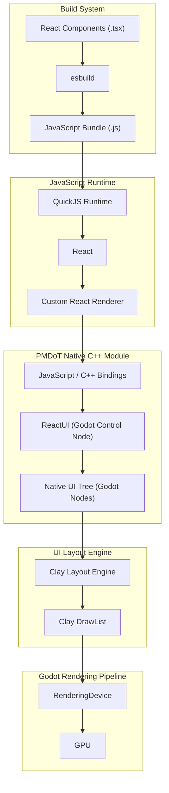

# Architecture Guidelines: react_ui system.

This document provides a comprehensive technical overview of the **PMDoT Engine** internal architecture, native C++ module integration of the React_Ui codebase.

---

## 1. High-Level Architecture Overview

PMDoT is a customized fork of **Godot Engine 4.3-stable** that uses **React** to build user interfaces.


--- 


## 2. Native React Components

### View
**Props:** `width`, `height`, `backgroundColor`, `padding`, `margin`, `gap`, `direction`, `align`, `justify`, `children`.

### Text
**Props:** `color`, `fontSize`, `fontFamily`, `fontWeight`, `textAlign`, `children`.

### Scroll
**Props:** `width`, `height`, `direction`, `scrollX`, `scrollY`, `scrollbarVisible`, `children`.

### Image
**Props:** `source`, `width`, `height`, `fit`, `opacity`.

### CustomShader
**Props:** `shader`, `uniforms`, `children`.

## 3. Data Flow: From TSX to Screen

```text
[React Components (.tsx)]
          │
          ▼
[esbuild: TSX → JavaScript Bundle (.js)]
          │
          ▼
[QuickJS executes the JavaScript bundle]
          │
          ▼
[React Renderer invokes native C++ bindings]
          │
          ▼
[ReactUI creates and manages the native C++ UI Tree]
          │
          ▼
[UI Tree elements are processed by Clay]
          │
          ▼
[Clay generates the DrawList]
          │
          ▼
[DrawList is submitted to Godot RenderingDevice]
          │
          ▼
[GPU renders the UI]
```
