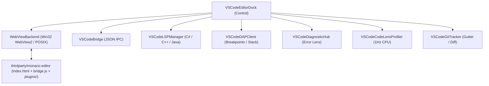

# Architecture Guidelines: Embedded VS Code (Monaco) IDE (`pmdot_vscode`)

Technical reference for the `pmdot_vscode` module in **PMDoT Engine (Godot 4.3-stable)**.

---

## 1. High-Level Architecture

---

## 2. Performance Design

1. **Pre-warmed WebView**: `VSCodeEditorDock::prewarm()` initializes the native WebView container on `NOTIFICATION_READY`, ensuring sub-frame (`<16ms`) tab switching.
2. **Debounced Diagnostics (Error Lens)**: `error_lens.js` debounces updates by `150ms` and uses `editor.deltaDecorations()` to preserve 60+ FPS typing.
3. **1 Hz Telemetry Polling**: `VSCodeCodeLensProfiler` throttles `Performance::get_singleton()` queries to `1000ms` and pauses when the IDE tab is hidden.
4. **Zero-Binary Windows Overhead**: `WebViewWindows` dynamically binds `WebView2Loader.dll` and uses `#1e1e1e` native background erase to prevent white flicker.

---

## 3. IPC Message Protocol (`VSCodeBridge`)

| Method | Direction | Payload |
|---|---|---|
| `open_script` | C++ -> JS | `{ path, content, language }` |
| `save_script` | JS -> C++ | `{ path, content }` |
| `content_changed` | JS -> C++ | `{ path, dirty }` |
| `apply_config` | C++ -> JS | `{ theme, fontSize, minimap, fontLigatures }` |
| `dap_breakpoints_updated` | C++ -> JS | `{ path, lines }` |
| `diagnostics_update` | C++ -> JS | `{ path, diagnostics }` |
| `perf_codelens_update` | C++ -> JS | `{ path, metrics }` |
| `git_gutter_update` | C++ -> JS | `{ path, hunks }` |
| `git_open_diff` | C++ -> JS | `{ path, original, modified, language }` |
| `git_status_update` | C++ -> JS | `{ branch, changes }` |
| `git_graph_update` | C++ -> JS | `{ commits }` |
| `tests_discovered` | C++ -> JS | `{ tests }` |
| `tests_finished` | C++ -> JS | `{ filter, passed, output }` |
| `logs_update` | C++ -> JS | `{ logs }` |
| `scene_graph_update` | C++ -> JS | `{ scenes }` |
| `todos_update` | C++ -> JS | `{ todos }` |

---

## 4. IDE Views & DevEX Extensions

- **SVG Codicons (`icons.js`)**: Monochrome VS Code-style vector icons across Activity Bar, File Explorer, Tabs, and Outline.
- **Explorer & Outline**: Project tree, Breadcrumbs, Quick Open (`Ctrl+P`), Command Palette (`Ctrl+Shift+P`), and debounced Symbol Outline.
- **Extensions Manager**: Toggleable *Error Lens*, *Performance CodeLens*, *Color Swatches*, *Bracket Colorizer*, and *Todo Tree*.
- **Run & Debug + Testing**: Clickable breakpoint gutter, DAP controls, and unified Unit (`--test`) / Integration (`.tscn`) test runner.
- **Source Control + Git Graph**: Stage/Unstage/Commit, Side-by-Side Diff Editor, and SVG commit timeline graph.
- **Remote, Docs & Scene Graph**: Runtime log stream, direct C#/C++/Godot/Google search links, `.tscn` Node Tree viewer, and `TODO`/`FIXME` scanner.

